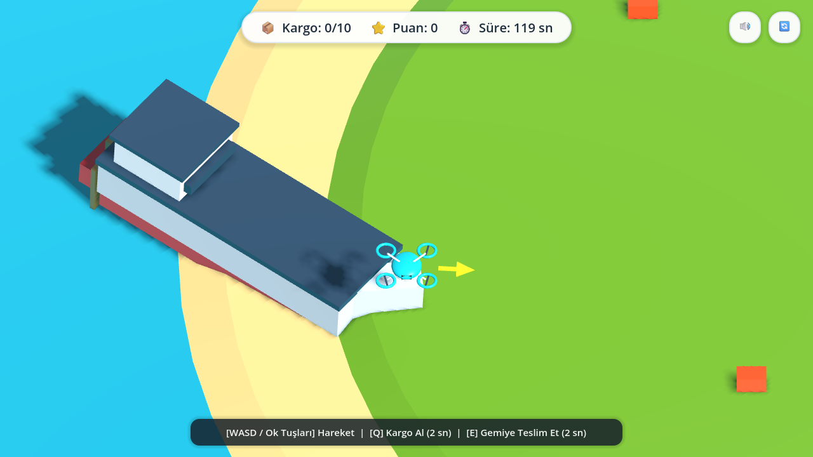
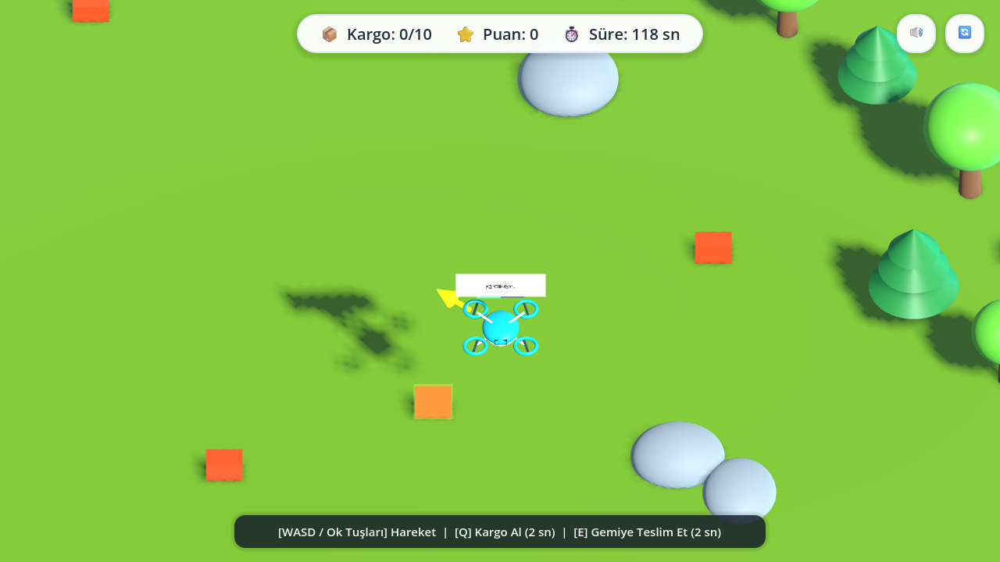
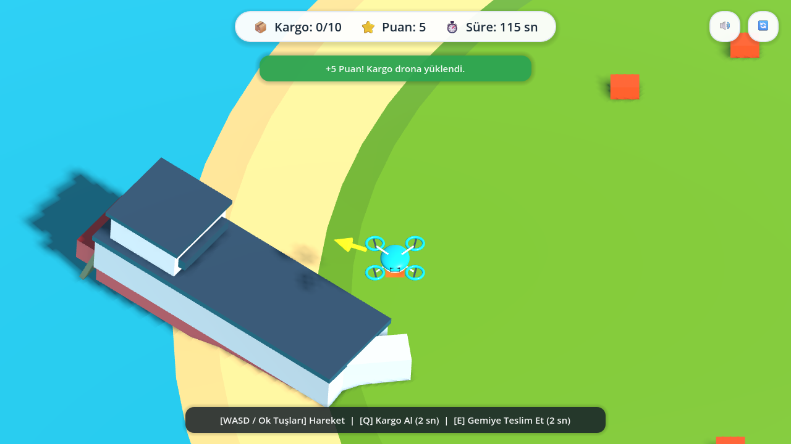

# ALIVE LANDING — 3D Hypercasual (Godot 4)

120 saniyede 10 kargoyu adadan alıp kıyıdaki gemiye teslim etmeye çalışan, tek dronlu bir 3D hyper-casual oyunu. Türkçe HUD, yön göstergesi, sentezlenmiş sesler ve GameUp tasarım belgesine sadık kurallar içerir.

---

## 🎯 Proje Amacı ve Üretim Süreci

Bu proje, **GameUp Türkiye** tarafından verilen oyun geliştirme eğitiminin **ödevi** olarak hazırlanmıştır. Belgedeki oynanış kuralları (120 sn süre, 10 kargo, 2 sn hareketsiz yükleme/teslim, +5/+5 puan, eşzamanlı bitişte kayıp, Türkçe arayüz) birebir uygulanmıştır.

Üretimde kullanılan araçlar:

- **Antigravity** — oyunun ilk sürümünün (sahneler, betikler, HUD) geliştirilmesinde kullanılan AI kod editörü.
- **OpenCode** — projenin incelenmesi, hata/eksik tespiti ve düzeltmelerinde kullanılan AI ajanı. Ortografik kamera, ışık paleti, ada/gemi yerleşimi, 3D yön oku, `Q`/`E` tekrar koruması, ilerleme çubuğu ve teslim alanı bu inceleme sonrasında düzeltilmiştir.
- **GPT / DALL·E** — görsel tasarım referansları üretildi (`reference_concept.webp`, `reference_hud.webp`). Bu görseller yalnızca ilham kaynağı değil, **somut tasarım hedefi** olarak kullanılmıştır.
- **Godot 4.7.2 + GDScript** — oyun motoru ve programlama dili (Forward+ / Compatibility).
- **PowerShell (`build_sounds.ps1`)** — 7 ses efektinin sıfırdan, prosedürel olarak sentezlenmesi. Harici ses varlığı kullanılmamıştır.

---

## 📸 Ekran Görüntüleri

**Oynanış — ada, gemi, dron ve yön oku**

**Kargo yükleme anı — 2 sn dolum çubuğu ve `[Q]` balonu**

**Kargo yüklü, gemiye teslim yaklaşırken**

---

## 🎮 Kontroller ve Oynanış

- **Hareket:** `W`, `A`, `S`, `D` veya `Ok Tuşları`
- **Kargo Yükleme:** Kargonun yanındayken `Q` tuşuna bir kez bas ve **2 saniye hareketsiz bekle**.
- **Gemiye Teslim:** Kıyıdaki geminin yanındayken `E` tuşuna bir kez bas ve **2 saniye hareketsiz bekle**.
- **Yeniden Başlat:** `R` tuşu veya sağ üstteki `🔄` butonu.
- **Ses Aç/Kapat:** Sağ üstteki `🔊` butonu.

---

## ✅ Tasarım Kuralları

- **Süre/kazanma:** 120 saniye içinde 10 teslim yapılırsa kazanılır. Süre bitmeden veya tam bitiş anında teslim tamamlanırsa **kayıp** sayılır; bitişte tüm hareket ve eylemler durur.
- **Puan:** Kargo alma +5, gemiye teslim +5 (toplam 100).
- **Tek seferlik eylem:** `Q`/`E` tuşuna bir kez basılır; basılı tutmak veya tekrar basmak 2 saniyelik sayacı **sıfırlamaz**.
- **Yönlendirme:** Dron boşken en yakın kargoya, kargo yüklüyken kıyıdaki gemiye dönen sarı 3D ok bulunur.
- **Kamera:** Dronu yumuşak takip eden, dönmeyen, ortografik görünüm (yaklaşık 20 birim genişlikte, eğik açıdan ~15 birimlik zemin alanı).
- **Dünya:** 100×100 birim; merkezde ada, çevresinde deniz, batı kıyısında sığ suda gri kargo gemisi.

---

## 🚀 Projeyi Godot'da Açma ve Çalıştırma

1. **Godot Engine 4**'ü açın.
2. Açılış ekranında **İçe Aktar (Import)** butonuna tıklayın.
3. Proje yolu olarak bu deponun kök klasöründeki `project.godot` dosyasını seçin.
4. **İçe Aktar ve Düzenle (Import & Edit)** butonuna tıklayın.
5. Sağ üstteki **Çalıştır (F5)** butonuna basarak oyunu başlatın.

---

## 📂 Proje Yapısı

- `project.godot`: Motor ayarları, tuş eşlemeleri ve çözünürlük (1280x720, 16:9).
- `scenes/`:
  - `main.tscn`: Ana sahne (ortografik takip kamerası, tek yönlü ışık, ada, gemi, dron, UI).
  - `drone.tscn`: 4 pervaneli turkuaz-beyaz kurtarma dronu, hedefe (kargo/gemi) dönen 3D sarı yön oku, 2 sn dolum çubuğu + konuşma balonu ve asılı kargo yuvası.
  - `ship.tscn`: Kıyıya oturmuş gri kargo gemisi, dönen bronz pervane, dümen ve teslim edilen kargo yuvaları.
  - `island.tscn`: Yeşil ada platosu, kumsal, turkuaz okyanus, çam ve yuvarlak ağaçlar, kayalar.
  - `cargo.tscn`: Parlak turuncu corrugated kargo konteynerleri ve etkileşim alanı.
  - `ui.tscn`: Türkçe HUD (Kargo, Puan, Süre), Başlangıç, Kazanma, Kaybetme ve Uyarı bildirimleri.
- `scripts/`:
  - `main.gd`: 120 saniye sayacı, oturum bazlı 10 kargo dağıtımı, kazanma/kaybetme kontrolü.
  - `drone.gd`: Sabit irtifa uçuşu, 2 sn hareketsizlik kontrolü, hedef takibi ve ses tetiklemeleri.
  - `ship.gd`: Gemi etkileşim bölgesi ve güvertedeki kargo görünürlük yönetimi.
  - `cargo.gd`: Kargo toplama ve vurgulama mantığı.
  - `ui.gd`: HUD sayaçları, modal pencereler ve animasyonlu Türkçe uyarı bildirimleri.
  - `audio_manager.gd`: 7 farklı ses efektinin döngü, ses seviyesi ve sessize alma yönetimi.
- `audio/`:
  - `propeller_hum.wav`: Dron motor/pervane uğultusu.
  - `charge.wav`: 2 saniyelik yükleme/indirme dolum sesi.
  - `success_ding.wav`: Başarılı kargo alma/teslim etme zili.
  - `warning_buzz.wav`: Hatalı veya yarıda kesilen eylem uyarı sesi.
  - `click.wav`: Düğme tıklama sesi.
  - `victory.wav`: 10 kargo tamamlandığında çalan zafer fanfarı.
  - `game_over.wav`: Süre bittiğinde çalan kaybetme melodisi.
